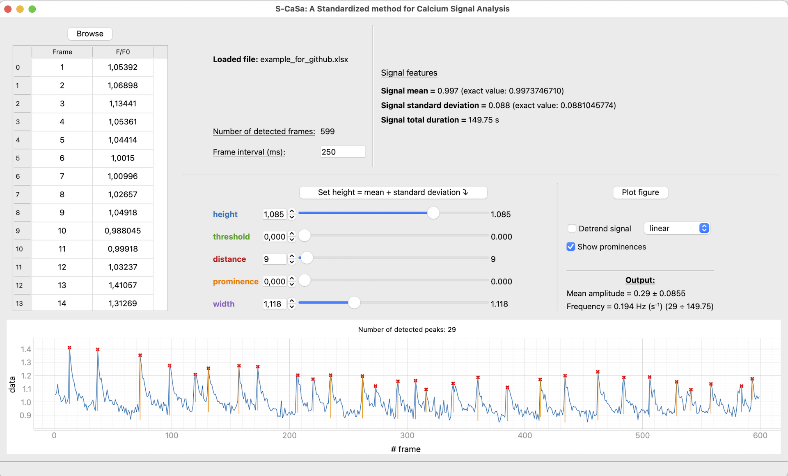

# S-CaSA

A **S**tandardized method for **Ca**lcium **S**ignal **A**nalysis

## Overview

This Python-based application provides a Graphical User Interface (GUI) for the analysis of calcium signals. It allows users to quantify and visualise key signal features, including frequency and amplitude, providing an intuitive tool for exploring and analysing calcium activity.

## GUI Preview



## Installation

```bash
$ cd s-casa/
$ conda env create --file environment.yml
$ conda activate s-casa
$ python scasa.py
$ conda deactivate
```
